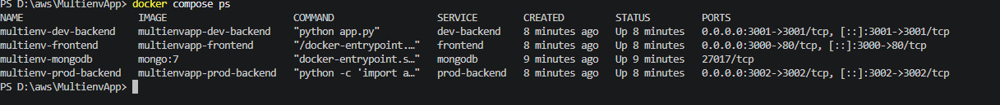
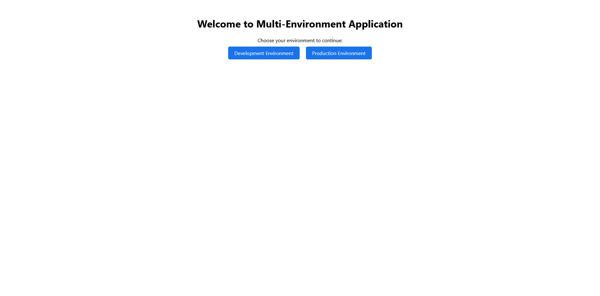
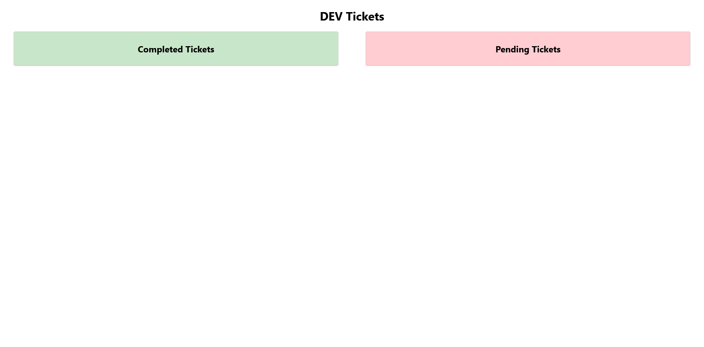
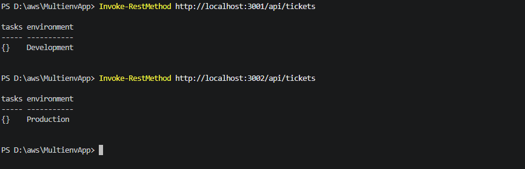

# Multi-Environment Ticket Management System

A full-stack ticket management application demonstrating development and production environments using React, Flask, MongoDB, Docker, and Docker Compose.

## GitHub Repository

**Repository URL:** https://github.com/karan11619/MultienvApp

## Project Overview

This project runs separate development and production Flask backend services alongside a React frontend and MongoDB database. Docker Compose builds, connects, and manages the application services on a shared Docker network.

### Technologies Used

- **Frontend:** React
- **Backend:** Python and Flask
- **Database:** MongoDB
- **Web Server:** Nginx
- **Containerization:** Docker
- **Orchestration:** Docker Compose

## Project Structure

```text
MultienvApp/
├── docker-compose.yml
├── README.md
├── backend/
│   ├── dev/
│   │   ├── app.py
│   │   ├── requirements.txt
│   │   ├── Dockerfile
│   │   ├── .env
│   │   └── templates/
│   └── prod/
│       ├── app.py
│       ├── requirements.txt
│       ├── Dockerfile
│       ├── .env
│       └── templates/
└── frontend/
    ├── Dockerfile
    ├── nginx.conf
    ├── package.json
    ├── public/
    └── src/
        ├── App.js
        └── pages/
```

## Architecture

The application consists of four Docker services:

| Service | Description | Host Port |
|---|---|---:|
| Frontend | React application served by Nginx | 3000 |
| Development Backend | Flask API for development | 3001 |
| Production Backend | Flask API for production | 3002 |
| MongoDB | Database for ticket storage | Internal port 27017 |

The services communicate through a shared Docker bridge network. The frontend is published on port 3000, while the backend APIs are accessible through their respective host ports.

The development and production environments use separate MongoDB databases.

## Prerequisites

Install the following tools before running the application:

- Docker Desktop
- Docker Compose
- Git

## Environment Configuration

The development backend uses `backend/dev/.env`:

```env
MONGO_URI=mongodb://mongodb:27017/dev_tickets
```

The production backend uses `backend/prod/.env`:

```env
MONGO_URI=mongodb://mongodb:27017/prod_tickets
```

The hostname `mongodb` refers to the MongoDB service inside the Docker Compose network.

**Security:** Do not commit real credentials, passwords, or secret keys to version control. Use appropriate environment variables and secret management for production deployments.

## Build and Run the Application

Clone the repository:

```bash
git clone https://github.com/mohanDevOps-arch/MultienvApp.git
cd MultienvApp
```

Build the images and start the services:

```bash
docker compose up --build -d
```

Check the status of all services:

```bash
docker compose ps
```

View application logs:

```bash
docker compose logs
```

View logs for a particular service:

```bash
docker compose logs frontend
docker compose logs dev-backend
docker compose logs prod-backend
docker compose logs mongodb
```

Stop the application:

```bash
docker compose down
```

To stop the services while retaining the named MongoDB data volume, use the command above without the `-v` option.

## Accessing the Application

Open the following URLs in your browser.

| Component | URL |
|---|---|
| React frontend | http://localhost:3000 |
| Development tickets page | http://localhost:3000/dev |
| Production tickets page | http://localhost:3000/prod |
| Development API | http://localhost:3001/api/tickets |
| Production API | http://localhost:3002/api/tickets |

## Service Testing and Verification

### 1. Verify Container Status

Run:

```powershell
docker compose ps
```

Confirm that the frontend, development backend, production backend, and MongoDB containers are running.

### 2. Test the Development API

Run in PowerShell:

```powershell
Invoke-RestMethod http://localhost:3001/api/tickets
```

The API response should identify the environment as `Development`.

### 3. Test the Production API

Run:

```powershell
Invoke-RestMethod http://localhost:3002/api/tickets
```

The API response should identify the environment as `Production`.

### 4. Verify the Frontend

Open the frontend, development page, and production page using the URLs listed above.

The development and production API responses may contain empty ticket collections when no tickets have been created.

## Deployment Screenshots

Screenshots documenting the local Docker deployment and verification are stored in the `screenshots/` directory.

### 1. Docker Compose Container Status

Shows the status of the application containers.



### 2. Frontend Home Page

Shows the React frontend running in the browser.



### 3. Development Environment

Shows the development tickets page.



### 4. Production Environment

Shows the production tickets page.


### 5. API Verification

Shows the development and production API responses.



## Troubleshooting

### Port Already in Use

If ports 3000, 3001, or 3002 are already occupied, stop the conflicting application or change the corresponding host port mappings in `docker-compose.yml`.

### Container Fails to Start

Check the service logs:

```bash
docker compose logs frontend
docker compose logs dev-backend
docker compose logs prod-backend
docker compose logs mongodb
```

Use the error messages to identify the cause.

### Changes Are Not Reflected

Rebuild and restart the application after changing Dockerfiles, dependencies, or application code:

```bash
docker compose up --build -d
```

### MongoDB Connection Issues

Check that the MongoDB container is running:

```bash
docker compose ps
```

Verify that the backend environment files use the correct MongoDB service hostname and database names.

### Frontend or API Is Not Accessible

Check the container status and confirm that the expected ports are published:

```bash
docker compose ps
```

Review the relevant service logs if the issue persists.

## Security Considerations

- Do not commit secrets or sensitive credentials.
- Keep development and production databases separate.
- Use authentication and authorization where required.
- Use HTTPS and appropriate security headers for public production deployments.
- Keep dependencies and container images updated.

## Conclusion

This project demonstrates a multi-environment application deployment using Docker and Docker Compose. It separates the frontend, development backend, production backend, and database into services that can be built, started, monitored, and tested independently.

The deployment was verified locally using Docker Compose and the development and production API endpoints.
